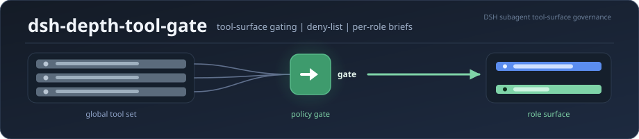
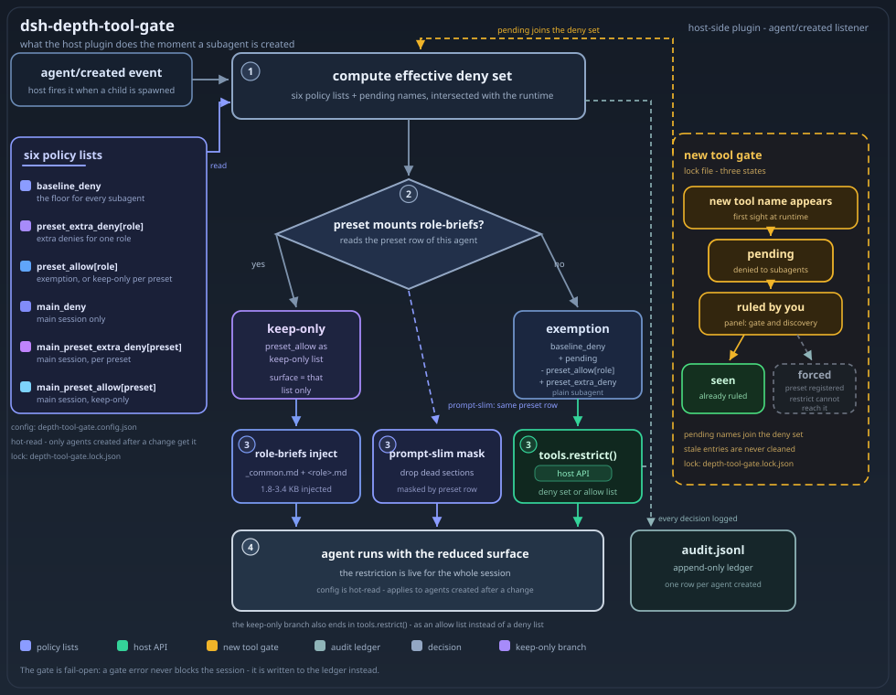

# 🚧 dsh-depth-tool-gate

<div align="center">

**Tool-surface governance for DeepSeek Harness — cut every subagent's tools down to what its job needs, and its prompt down to what it must read.**

<p>
  <a href="https://www.npmjs.com/package/dsh-depth-tool-gate"></a>
  <a href="./LICENSE"></a>
  = 24.9">
</p>

<p><b>English</b> · <a href="README.zh.md"><b>中文说明</b></a></p>



</div>

---

**dsh-depth-tool-gate** is a governance plugin for [DeepSeek Harness](https://www.npmjs.com/package/@deepseek-ai/dsh) (DSH). It controls **which tools each agent can see** and **how much instruction text each agent carries** — at the host level, where it cannot be talked out of.

A DSH subagent inherits the main session's entire tool catalog and the full global instruction set, whether it needs them or not. A "read these three papers" worker ends up holding image-generation, plugin-management, system-restart and scheduling tools it will never use — each one carrying a schema that is re-sent on every turn. dsh-depth-tool-gate cuts that down by policy, records what it did, and lets you audit the result.

> **Quick start** — DSH ≥ 0.2.2-rc.1, Node ≥ 24.9.0. In your DSH profile directory (`~/.dsh/profiles/web`): `npm i dsh-depth-tool-gate`, then **append** `"dsh-depth-tool-gate"` to the `dsh.profile.bundles` array in that profile's `package.json`, restart DSH, and open **Settings → Subagent Tool Surface**. Full steps and prerequisites: [Install](#install).

**Current version v0.16.15** · 中文说明见 [README.zh.md](README.zh.md) · 中文文档 `docs/*.md`

---

## The problem, concretely

| | Without a gate | With dsh-depth-tool-gate |
|---|---|---|
| **Tool catalog** | Every subagent inherits the host's full global tool set — measured at 90 tools ≈ 33k tokens of schemas, re-sent every turn (measured on DSH 0.2.2-rc.1) | Each agent sees only what its role needs — the `reader` capability tag resolves to 9 tools, i.e. ≈29k tokens less per turn |
| **New tools appearing** | A DSH upgrade or a newly installed plugin silently widens every subagent's surface | New tool names are held in a **pending gate** and blocked until you rule on them |
| **Prompt budget** | Subagents inherit the full global instruction file (tens of KB) plus injected sections about tools they do not have | Per-role briefs replace the bulk of it (1.8–3.4 KB in the shipped presets), and sections about absent tools are masked out (≈4.4 KB of dead sections dropped, measured with `provenance_audit`) |
| **Wasted capability** | A subagent holds "restart the whole system" or "install software" next to "read a file" | Dangerous and irrelevant tools are denied by name, per role |
| **Auditability** | Whatever the tool surface is, it is invisible | Every decision is written to an append-only JSONL ledger, with a panel that replays it |
| **On-demand minimalism** | A task needs one narrow tool set, so it gets all of them | `dispatch_composed` assembles a temporary minimal surface from capability tags |

---

## How it works



Everything happens on `agent/created` — the moment the host finishes creating an agent, before it starts working:

1. **Compute** the effective deny set for that agent from the six policy lists below.
2. **Branch** on depth — a main session (depth 0) and a subagent (depth > 0) read different lists: the main session reads `main_deny` / `main_preset_*`, a subagent reads `baseline_deny` ∪ `pending` with `preset_allow` acting as an exemption set.
3. **Apply** the result through the host's `tools.restrict()` API, and inject the per-role brief and the prompt masking.
4. **Log** the decision to the append-only ledger, whether or not anything was cut.

---

## What it actually does

### 1. Deny-list gating (the core)

On `agent/created`, the plugin computes the effective deny list for that agent and applies it through the host's `tools.restrict()` API.

Six lists, each with its own scope. The subtle one is `preset_allow`, because its effect depends on **which side** it is read from:

| List | Applies to | Meaning |
|---|---|---|
| `baseline_deny` | all subagents (depth > 0) | the floor — tools no worker should have |
| `preset_extra_deny[preset]` | one role | additional denies for that role |
| `preset_allow[preset]` | one role | for a **subagent**: an **exemption list** — these names are removed from the deny floor, everything else still gets denied |
| `main_deny` | the main session (depth 0) | tools you don't want in your own session either |
| `main_preset_extra_deny[preset]` | a main session opened with that preset | role-specific denies layered on top of `main_deny` |
| `main_preset_allow[preset]` | a main session opened with that preset | **keep-only** for that main session: only the listed tools stay visible |

Order of application for a **subagent**: `baseline_deny` ∪ `pending` → minus `preset_allow[preset]` → plus `preset_extra_deny[preset]`.

> ★ **There is no "mounts `role-briefs` ⇒ keep-only" rule.** An earlier version (v0.7.1) did apply `preset_allow[brief]` as a keep-only list from the brief module, but it was **removed in v0.14.5**: it wrote its restriction on the preset *generation* layer (shared by every session under that preset) and read the tool set through a scope-less view, so the router's visible surface collapsed to 6 tools and its main dispatch channel never showed up. The plugin now only injects prompt briefs; **all trimming authority lives in the host side**. A subagent that needs a keep-only surface gets one through `dispatch_composed`, not through a preset list.

For a **main session**: if an allow-list applies it becomes keep-only (and `main_deny` is not layered on); otherwise `main_deny` ∪ `main_preset_extra_deny[preset]` is denied. Note that `main_preset_allow` falls back to the shared `preset_allow[preset]` key when the former is not set — and the shared key is keep-only on the main-session path too. The plugin logs a warning when that fallback happens, so you can spot it in the host log.

A `PROTECTED_MAIN` set (18 core tools: file access, planning, the user-interaction tools…) is **not a trimming gate**: naming one of them still trims it, and the plugin only warns about the consequence (a crippled session) and records it in the audit trail as `blockedProtected`. Tool-surface governance executes the user's choice faithfully and reports the outcome; it does not make "slip protection" decisions on the user's behalf (the user explicitly requires that every tool stay disable-able per preset). The keep-only path (`main_preset_allow`) trims them just the same.

**Timing:** configuration is hot-read, but a change applies only to agents **created or resumed** after it — running sessions keep the surface they were born with.

**First run:** the gate seeds itself from the tools already present at install time and marks them `seen`, so the *new-tool gate* does not block anything on day one (your configured deny lists still apply, of course). Only tools that appear *later* (a DSH upgrade, a newly installed plugin) enter `pending`. If the pending list is empty right after installation, that is the expected state, not a broken gate.

### 2. The new-tool gate (lock)

Any tool name the runtime has never seen before is recorded as `pending`. With `autoDenyNew` on (the default), pending names are denied to subagents until you rule on them.

```
pending  →  denied to subagents, waiting for a ruling
seen     →  already ruled (allowed or denied), stays as-is
forced   →  registered by a preset, so restrict() cannot reach it — shown greyed out
```

Stale entries are **never cleaned up**: if a plugin you disabled comes back, the gate remembers and it takes effect again.

### 3. Preset access control

You can forbid a preset from being used as a subagent. The child is still spawned (the block happens after creation, so a slot is briefly consumed), then restricted to a minimal reporting surface (`note_search`, `send_message`); the event is recorded in the ledger as `preset-denied`. This fails **closed**: if the restriction cannot be applied, the child gets *no* tools rather than all of them.

> Known limitations: the block happens after the child is created, so the spawn still consumes a slot (entry-point validation is a planned improvement); and hiding is limited to the `list_agent_presets` tool — the host's own preset list in the UI still shows the preset.

> Note the name collision: `preset_deny` is about **presets**, while `preset_allow` / `preset_extra_deny` are about **tools**. Putting a preset id into a tool list does not disable the preset.

### 4. On-demand minimal surfaces (`dispatch_composed`)

Instead of picking a preset, you can assemble a surface from capability tags:

```js
dispatch_composed({
  prompt: "Extract the key findings from these papers and write them to findings.md",
  capabilities: ["literature"],       // union of tag allow-lists
  tools: ["write"],                     // extra names, merged in
  description: "literature digest ×1"
})
```

The child is born with **only** the union's tools — everything else, including tools that appear later, is invisible to it. Tag definitions live in `capabilities` in the config and are fully overridable. A tag whose allow-list contains `dispatch_composed` additionally lets the child spawn one more generation; the built-in `reader-lead` and `literature-lead` tags do. There is no `-lead` suffix parser — "lead" is simply a property of the tag's tool list.

**Parallel dispatch.** Pass `tasks[]` to spawn several independent children at once — each with its own prompt and its own surface, none waiting on the others:

```js
dispatch_composed({
  tasks: [
    { prompt: "Read paper A and summarise its findings", capabilities: ["reader"], description: "paper A" },
    { prompt: "Read paper B and summarise its findings", capabilities: ["reader"], description: "paper B" },
    { prompt: "Extract every DOI from the bibliography", capabilities: ["literature"], description: "DOIs" },
  ]
})
```

**Async by default.** The call returns the children's ids immediately; each child's result arrives later as a message from the host — the same shape as the host's own `subagent` tool. Pass `wait: true` when you need the results in hand before continuing (that blocks until all of them finish).

**A resumed child keeps its surface.** Sending a follow-up to a child that already finished re-materialises it; the gate re-applies the *same* allow-list rather than falling back to the generic deny list, so the tool surface does not shift underneath a continuing conversation.

### 5. Per-role instruction briefs (`role-briefs`)

Instead of loading the whole global instruction file into every subagent, each role gets a compact brief: a shared `_common.md` plus a role-specific file, injected as a system-prompt section (so it can be attributed byte-precisely by `provenance_audit`). Budget target: ≤3 KB per child.

### 6. Prompt-section masking (`prompt-slim`)

A preset can mask named global system-prompt sections by registering same-named empty sections — the host's scoped-shadow mechanism then drops them entirely for that preset. A child that has no scheduling tools does not need the scheduling instructions.

### 7. The panel (9 tabs)

Settings → **Subagent Tool Surface** (子代理工具面). A **version badge** sits at the right of the panel title (since v0.16.8): it shows both the client version (the panel UI) and the host version (the trimming/gate/ledger code actually running); when they differ it flags "host x.y.z pending restart" — editing `client.js` takes effect on a browser refresh, while host-side changes need a DSH restart.

| Tab | What it does |
|---|---|
| 📋 全局工具面 / Global tool surface | Three top-level zones: **disabled list (subagent deny)** / **disabled list (main-session deny)** / **🟢 runtime tool surface (common tools + not-yet-ruled-on)** — since v0.16.11 the last two are merged into ONE resident zone (common-tools subsection with per-tool purpose + both checkboxes on top; not-yet-ruled-on subsection with source filter, per-tool explainer, batch prompt below). Un-denying a tool lands it back in this always-visible zone; checking it moves it to the disabled list above — every tool's in/out is traceable, nothing vanishes. Each disabled layer owns its own zone (fallback group collects only that layer's entries ⇒ no double render); a summary line breaks the overlap into "denied in both N / subagent only N / main-session only N". Also holds the bulk `main_deny` editor |
| 🧭 主会话与访问 / Main session & access | Which presets may be dispatched at all; plus per-role denies for main sessions. Both are top-level collapsible zones, each with its **effective-logic explainer**. Since v0.16.11 the per-role zone also has a **per-tool checkbox editor for `main_preset_allow`** (keep-only positive list: check = keep the tool; enable seeds from the current effective face (or restores your last selection); disable remembers your choice then deletes the key back to fallback; a clear-to-empty option lets you check only the few tools you want; warns that unchecked tools are all trimmed incl. core, and an empty list `[]` trims everything). The raw-JSON editor remains as an advanced fallback. v0.16.11 also fixed the `splitAllow` client wiring (the split button used to throw "unknown op") |
| 👥 子代理按角色 / Subagents by role | The final deny surface per role, and the raw list editors |
| 🧪 能力标签 / Capability tags | The tag → allow-list table used by `dispatch_composed`. The **default tag table ships with the plugin** (so anyone who installs it has the tags, no manual setup); the decision-surface catalogue is **generated automatically and written to disk** (re-generated on refresh ⇒ hot), and it is injected only into decision-surface roles |
| 📝 工具说明 / Tool annotations | The per-tool purpose ledger: how many annotations are on file, how many pass the quality gate, and the queue of tools still needing one — editable in place |
| 📊 调用频率 / Call frequency | Per-tool and per-preset call counts, plus the most recent 40 sessions (per-session breakdown; older sessions drop out of the list) |
| 📜 裁剪台账 / Audit ledger | One row per agent creation, plus red rows for governance events (lock corruption, config corruption, gate errors, missing briefs) |
| 🚦 闸门与发现 / Gate & discovery | Pending rulings (four actions per tool), and a per-item reason for every stale list entry |
| 🔍 生效面预览 / Effective-face preview | Read-only observation (no checkboxes): pick a preset and see, after all governance logic on the saved config, each tool's final state √ visible / × trimmed, in two columns — main session (hand-opened depth0 with that preset) and child session (dispatched subagent). Hover √/× for the reason. Backed by host `previewFace`, a pure read-only simulation reusing the enforcement functions |

### 8. Read-only diagnosis (`explain_gate`)

`explain_gate` is a **tool that agents call inside a DSH session** — it is not a shell command. It explains the *current* agent's surface and the reason for every cut, without changing anything:

```
[explain_gate] 可见 99/116 | 裁 17 件
  按归因汇总:
    · main_deny(主会话显式名单) — 17 件
  逐件明细:
  ✂ generate_image — main_deny(主会话显式名单)
  ✂ mcp__codex__codex — main_deny(主会话显式名单)
```

The output has two layers: a **per-reason summary** (counts are never truncated — that is the complete answer to "what am I missing") and then the **per-tool detail** (up to 200 lines; if more remain it says so explicitly, rather than showing a short list under a larger count).

(Each line names the list responsible for the cut. The reasons are mutually exclusive per scope: a **main session** can report `main_deny`, a **subagent** reports `baseline_deny` / `preset_extra_deny` / `preset_allow 正面清单外` / `lock pending`. Ask the agent in your session to run it, or call it from a tool-use turn. The counts above are illustrative; they depend on your own lists.)

### 9. Per-tool purpose annotations (`describe_tools`)

Every governed tool gets a **one-line statement of what it is for**, maintained automatically as tools are discovered:

| Stage | Rule |
|---|---|
| **Discovered → annotated** | When a tool is first seen by the runtime (the same point the gate sees it), its `definition.description` is reduced to its first sentence → an annotation exists immediately |
| **Stored in full** | The ledger keeps the **complete** description, not a truncated one. A short summary is derived only for the panel's list view and is never written back |
| **Manual wins** | A note you write in the panel is never overwritten by the automatic pass; clearing it falls back to automatic |
| **Quality gate** | Non-empty · ≥12 bytes · **information gain over the tool name** (the note must contain a real word besides the tool's own name). Failing tools land in a *needs annotation* queue |
| **Model-side lookup** | `describe_tools` returns the **full** note on demand — `names` to ask about specific tools, `keyword` to find tools by what they do, neither to list the visible surface. It does **not** go into the system prompt, so it costs nothing when unused |

> **Why the full description is kept.** Truncating a tool's description to a name-matching token destroys exactly the dimension that distinguishes tools — measured on the real session: 93 of 98 tools truncated, 31,297 bytes lost, and what was lost was the differentiating half of each note. A short note does not just save tokens; it suppresses tool availability and assignment precision.

The ledger is **whole-registry** ("visible" is only a label), so a decision-facing agent can look up the notes of tools outside its own surface.

### 10. The capability catalogue (a decision face does not need schemas)

A router needs to know **which capabilities it can dispatch and what each one does** — not 19 tool schemas. The plugin therefore maintains a compact catalogue:

```
# 能力标签目录 (9 标签)
- literature (26): 多库学术检索(8库+3引擎)+引文核验+文献抽取
- reader (10): 网页与文件轻读(只读面, 不写不派)
...
```

Measured on a real session: the main session carried **87,947 bytes** of tool definitions (40,811 descriptions + 47,136 parameters); the router face carried **21,029 bytes** and knew only 19 tool *names* — nothing about what those tools did. The catalogue covers the same ground in **753 bytes**.

It is generated at **deploy time** and injected into decision-facing role briefs (the injection whitelist currently covers **only `cordis-router`**), because switching surfaces mid-session loses more than it saves (measured cache hit rate: 86.3%; break-even is ~16 turns, while the catalogue is re-sent a median of 4 times per session).

---

## Install

**Step 1 — add the package to your DSH profile** (run this in your DSH profile directory, e.g. `~/.dsh/profiles/web`, so the dependency lands in that profile's `package.json`):

```bash
cd ~/.dsh/profiles/web        # your profile dir
npm i dsh-depth-tool-gate
```

**Step 2 — register the bundle.** Edit the *same* profile `package.json`: add `"dsh-depth-tool-gate"` to the **end of the existing `dsh.profile.bundles` array**. Keep the entries you already have — the array is replaced wholesale if you paste a shorter list over it.

```jsonc
{
  "dependencies": {
    "dsh-depth-tool-gate": "^0.16.15"
  },
  "dsh": {
    "profile": {
      "bundles": [
        "@deepseek-ai/dsh-base",
        "@deepseek-ai/dsh-web-app",
        "dsh-depth-tool-gate"        // ← append, don't replace the list
      ]
    }
  }
}
```

**Step 3 — restart DSH** (the host half is loaded at boot), then open **Settings → Subagent Tool Surface**. If that panel is missing, the bundle did not load — check that the package is installed in *this* profile and that the name is spelled exactly `dsh-depth-tool-gate`.

**Step 4 — verify.** Ask your agent to call `explain_gate`; it should report a visible count and the tools it cut, with a reason for each.

### Install it with an agent (copy-paste prompt)

If you would rather let an agent do the whole thing, paste this prompt into any DSH session that has file and shell access. It installs the package into the profile, registers the bundle **without overwriting the existing list**, and stops before the restart so you can see what changed:

```
Install the DSH plugin "dsh-depth-tool-gate" for me.

Do exactly this, and nothing else:
1. Determine my active DSH profile directory (the profile whose package.json
   contains dsh.profile.bundles; do not assume ~/.dsh/profiles/web).
2. In that profile directory, run `npm i dsh-depth-tool-gate`.
3. Edit that same profile's package.json: add "dsh-depth-tool-gate" to the END
   of the existing dsh.profile.bundles array. Keep every entry that is already
   there — append, never replace the list.
4. Show me the diff of package.json and stop.

Do NOT restart DSH yourself — I will do that. Do NOT edit any other file.
After I restart, I will ask you to call explain_gate to verify.
```

If your agent has the `plugin_manager` tool, the equivalent one-liner is:

```
plugin_manager(action="install_bundle", target="dsh-depth-tool-gate")
```

> **Why the "append, don't replace" wording matters.** `dsh.profile.bundles` is replaced
> wholesale if a shorter list is pasted over it — the profile then loads without
> `@deepseek-ai/dsh-base` and the harness comes up broken. This is the single
> most common way a profile install goes wrong.

### Requirements

- **DSH ≥ 0.2.2-rc.1** — the plugin relies on four host-internal behaviours: `tools.restrict()` / `tools.view()` exist and fail loudly on unknown names, `view()` takes a scope key, the "own" layer is exempt from restrictions, and restrictions compose as an intersection. It also uses `createScope()` from `@deepseek-ai/dsh-scope`, passing only the context and key (its third `options` argument is not used).
- **Node ≥ 24.9.0** (matches the host).
- Peer packages are provided by the host: `@deepseek-ai/dsh-scope`, `@deepseek-ai/dsh-typert-protocol`. They are declared as optional peer dependencies, and **since v0.14.0 the plugin resolves them at runtime instead of importing them statically** — it asks the host for its own copy via `profileContext.installAnchor`, so the plugin and the host share one instance (two instances would give `dsh-scope` two different scope tags and silently break `tools.restrict()`). Nothing to install by hand. If the host cannot be reached, the plugin refuses to pretend it governs: it logs `peer-missing`, marks the panel degraded with the reason, and records it in the audit ledger.

---

## Configuration

`$DSH_HOME/profiles/<profile>/depth-tool-gate.config.json` — hot-read, and rewritten by the panel.

The file itself must be **strict JSON** (no comments, no `…` placeholders). The block below is annotated for reading only; the panel writes a valid file for you:

```jsonc
{
  "enabled": true,
  "autoDenyNew": true,                // block tool names that appear later, until ruled on
  "baseline_deny": ["tool_name"],      // the floor for all subagents
  "preset_allow": { "my-role": ["tool_name"] },        // exemption from the floor, per role
  "preset_extra_deny": { "my-role": ["tool_name"] },  // extra denies, per role
  "main_deny": ["tool_name"],         // the main session only
  "main_preset_allow": { "my-preset": ["tool_name"] },        // keep-only, main session
  "main_preset_extra_deny": { "my-preset": ["tool_name"] },  // extra denies, main session
  "preset_deny": ["some-preset"],     // this preset may not be used as a child
  "preset_supplement": ["some-preset"],  // re-attach this preset's tools to externally dispatched sessions
  "capabilities": { "my-tag": ["tool_name"] }  // tags for dispatch_composed
}
```

Key notes:

- `preset_supplement` exists for presets whose sessions are dispatched through a channel that does not mount the preset's own rows (for example a flat peer session). For those, the preset's `preset_allow` list is re-attached as missing tools. Leave it empty unless you know you need it.
- `capabilities` **replaces** the built-in tag table when it is present **and non-empty** (an empty object falls back to the built-in table). Built-in tags:

  | Tag | Tools | Of those, MCP tools |
  |---|---|---|
  | `reader` | 10 | 0 |
  | `reader-lead` | 11 | 0 |
  | `ocr` | 11 | 2 |
  | `literature` | 24 | 15 |
  | `literature-lead` | 25 | 15 |

  ★ These are the **built-in fallback** table, not a limit: the moment you define `capabilities` in your config, your table replaces it wholesale and the built-in one is never consulted again. A production profile commonly runs a wider table (nine tags: the five above plus `orchestrator`, `bio`, `web-report` and `router`).

  Every tag carries `describe_tools` (a read-only lookup of every governed tool's one-line purpose), so a composed agent can check what a tool actually does before calling it — **including orchestration tags** (`router`, `orchestrator`): a dispatcher that cannot see what the tools do cannot compose them reliably, so it needs the same lookup entry point as an executor.

  Every tag also carries `explain_gate` (a read-only diagnostic that reports which tools were cut and by which rule). It is what lets a composed agent honour the "if a tool is missing, self-diagnose before reporting" rule: a keep-only surface hides everything outside its allow-list, so without `explain_gate` in the list the agent can only say "I don't have that tool" — without the attribution that tells the parent where to look. `explain_gate` is read-only and is not itself subject to any gate, so listing it carries no governance risk.

  The MCP-based tags name tools from MCP servers that only exist if you have those servers installed. Missing MCP tools are **dropped from the allow-list** (and counted as `droppedUnknown`), while the remaining built-in tools still apply — so `literature` degrades to its 7 non-MCP tools rather than to an empty surface. If your tool set differs, define your own tags.
- An **unknown** capability tag is a hard error: the dispatch is rejected with `未知能力标签: <tag>` and the list of available tags. It does not silently fall back.

Companion files, all under `$DSH_HOME`:

| Path | Role |
|---|---|
| `profiles/<profile>/depth-tool-gate.config.json` | policy (above) |
| `profiles/<profile>/depth-tool-gate.lock.json` | the new-tool gate state — maintained by the plugin, do not hand-edit |
| `profiles/<profile>/depth-tool-gate.usage.json` | call-frequency snapshot |
| `logs/depth-tool-gate/audit.jsonl` | append-only audit ledger |
| `logs/depth-tool-gate/spill/composed-reply-*.md` | full text of a `dispatch_composed` reply that exceeded the inline reply limit (64 KB) — the agent gets the path back and can read it |
| `node_modules/dsh-depth-tool-gate/agents-briefs/` | the role briefs the `role-briefs` plugin reads — `_common.md` plus one file per role |

The briefs live **inside the installed package**, next to `role-briefs.mjs` — not in your profile. To add your own role, drop a `<role>.md` file in that `agents-briefs/` directory and reference it from a preset row with `config: { brief: "<role>" }`. Two caveats: files added there live under `node_modules`, so **an npm upgrade replaces them** — keep your own copies elsewhere and re-add them; and a brief that cannot be read is **not** fatal: the plugin logs a `role-brief-missing` event and continues, but that agent then runs with no role guidance at all — so check the ledger if a subagent seems to be missing its instructions.

### Presets included in the bundle

| Preset | Purpose |
|---|---|
| `dtg-shell` | an empty shell used as the base for `dispatch_composed` children (required by that feature) |
| `cordis-sub` | a general-purpose subagent preset with a brief injected |
| `cordis-router` | a dispatch-only main session preset: no execution tools, delegation only |

> **Start here if you just installed this**: [New-user framework](docs/new-user-framework.md) —
> what you got, who reports to whom, and how to dispatch work.

---

## Privacy

- The call-frequency collector records **tool names and counts only**. Arguments and tool content are never stored.
- The audit ledger records agent ids, depths, preset names, counts and rule decisions — not what the agents said or did. It does let you reconstruct *when* a given preset spawned which agents, so treat it as operational metadata.
- A `dispatch_composed` reply longer than 64 KB is written in full to `logs/depth-tool-gate/spill/composed-reply-*.md` — that file contains the subagent's **actual output text**. It stays on disk until you delete it.
- All data stays on your machine under `$DSH_HOME`: no telemetry, no network calls, no install scripts.
- All timestamps are stored in UTC and displayed in your local timezone.

---

## Documentation

| Document | What it covers |
|---|---|
| [New-user framework](docs/new-user-framework.md) | **start here** — the architecture you get after installing: roles, faces, dispatch paths, boundaries |
| [Panel guide](docs/panel-guide.md) | every tab, field by field |
| [Agent FAQ](docs/agent-faq.md) | how the mechanism works, from an agent's point of view |
| [Adjustment guide](docs/adjustment-guide.md) | **how to adjust** — intent→channel decision tree, semantics traps, effect timing, safe workflow |
| [Troubleshooting](docs/troubleshooting.md) | silent-degradation family first: what to check, in what order |
| [Audit schema](docs/audit-schema.md) | every field of the ledger and the lock file |
| [Tool annotations](docs/tool-annotations.md) | what each governed tool is, and why it is governed |
| [Preset policy](docs/preset-policy.md) | the two-list governance model and the per-preset keys |
| [Roadmap](docs/roadmap.md) | **not implemented yet** — open items with the evidence behind each |
| [Changelog](versions.md) | release history |

---

## Development

The repository is the single source of truth; `scripts/release-export.mjs` produces the publishable snapshot (staged, assertion-checked, then swapped atomically).

```bash
node --check host.v2.mjs && node --check client.js   # syntax
node scripts/smoke-save-nopresetmap.mjs                # host regression smoke
node scripts/smoke-readme-facts.mjs                    # README-vs-code fact gate
node scripts/client-smoke.mjs                          # client-side contract smoke
node scripts/probe-save-runtime.mjs                    # save() runtime probe
node scripts/release-export.mjs                        # build + assert the release snapshot
```

Release notes are in [versions.md](versions.md). The package ships the runtime, the client half, the locale files, the bundle patch, the role briefs, the `docs/` guides listed above, the diagrams and the changelog.

Development-only assets — surgery scripts, archaeology notes, the internal release manual — live under `internal/` in the repository and are **not published** in the npm package.

---

## License

MIT — see [LICENSE](./LICENSE).

The plugin is an independent community project for DSH; it is not affiliated with or endorsed by DeepSeek.
