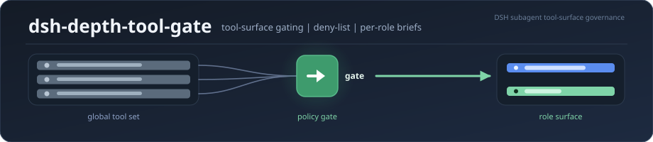

# dsh-depth-tool-gate

**[English](README.md)** · 中文

<div align="center">

**面向 DeepSeek Harness 的工具面治理插件 —— 把每个子代理的工具裁到岗位真正需要的，把它的引导裁到真正要读的。**

<p>
  <a href="https://www.npmjs.com/package/dsh-depth-tool-gate"></a>
  <a href="./LICENSE"></a>
  = 24.9">
</p>



</div>

---

**dsh-depth-tool-gate** 是 [DeepSeek Harness](https://www.npmjs.com/package/@deepseek-ai/dsh)（DSH）的**工具面与提示预算治理插件**。它管两件事：**每个 agent 能看到哪些工具**、**每个 agent 携带多少引导文本** —— 而且是在宿主层做的，绕不过去。

DSH 的子代理默认继承主会话的**全部工具**与**全部全局引导**：一个"读三篇论文"的干活代理，照样握着文生图、插件管理、系统重启、定时任务这些它永远不会用的工具 —— 每件工具的 schema 都要在**每一轮**重新发送一遍。dsh-depth-tool-gate 按策略把这些裁掉，并留下可查的账。

> **快速开始** —— 需 DSH ≥ 0.2.2-rc.1、Node ≥ 24.9.0。在你的 DSH profile 目录（`~/.dsh/profiles/web`）下执行 `npm i dsh-depth-tool-gate`，然后把 `"dsh-depth-tool-gate"` **追加**到该 profile `package.json` 的 `dsh.profile.bundles` 数组末尾，重启 DSH，打开 **设置 → 子代理工具面**。完整步骤与前置条件见 [安装](#安装)。

**当前版本 v0.13.2** · English see [README.md](README.md) · 中文文档 `docs/*.md`

---

## 问题，具体是什么样子

| | 没有闸门 | 装了 dsh-depth-tool-gate |
|---|---|---|
| **工具目录** | 每个子代理都继承宿主的全套全局工具 —— 实测 90 件 ≈ 33k token 的 schema，每轮重发一次（实测于 DSH 0.2.2-rc.1） | 每个 agent 只看到岗位需要的 —— `reader` 能力标签解析出 8 件工具，即每轮少付 ≈29k token |
| **新工具冒出来** | DSH 升级或新装插件，你的子代理工具面就悄悄变宽 | 新工具名进入**待裁决闸门**，挡住等你裁决 |
| **提示预算** | 子代理继承全量全局引导（几十 KB），外加关于它根本没有的工具的注入段 | 改为按岗位给短引导（随包三个岗位实测 1.8–3.4 KB），并遮蔽掉关于缺失工具的死段（`provenance_audit` 实测少读 ≈4.4 KB） |
| **能力浪费** | 一个子代理握着"重启整个系统""装软件"，旁边就是"读文件" | 危险与无关的工具按岗位逐个禁用 |
| **可审计** | 工具面是什么，全看不见 | 每个决策都写进 append-only JSONL 台账，面板可回放 |
| **按需最小面** | 任务只需要一套窄工具，于是给它全套 | `dispatch_composed` 按能力标签临时组装一个最小面 |

---

## 工作原理


<sub>英文版：[Gating flow](docs/gating-flow.svg)</sub>

全部动作都发生在 `agent/created` —— 宿主刚把 agent 创建完、还没开始干活的那一刻：

1. **计算**：按下面六张名单算出这个 agent 的有效禁用集合；
2. **分支**：判断该 agent 是否跑在挂了 `role-briefs` 的 preset 下 —— 这决定 `preset_allow` 是按"豁免"还是按"keep-only"生效；
3. **执行**：用宿主的 `tools.restrict()` 施加结果，同时注入岗位引导与提示段遮蔽；
4. **记账**：把这次决策写进台账 —— 裁没裁都写。

---

## 核心机制

### 1. 负面清单闸门（本体）

`agent/created` 时按名单算出禁用集合，用宿主 `tools.restrict()` 强制裁剪。

六张名单各有作用域。最微妙的是 `preset_allow` —— 它的效果**取决于该 agent 跑在哪个 preset 下**：

| 名单 | 作用域 | 含义 |
|---|---|---|
| `baseline_deny` | 所有子代理（depth > 0） | 地板 —— 任何干活代理都不该有的工具 |
| `preset_extra_deny[preset]` | 某个岗位 | 该岗位额外禁用的 |
| `preset_allow[preset]` | 某个岗位 | 对**普通子代理**：豁免集 —— 这些名字从地板里减掉，其余照禁。对**挂了 `role-briefs` 模块的 preset**（随包三个都挂了）：**keep-only** 集 —— 该 agent 最终只剩这些工具 |
| `main_deny` | 主会话（depth 0） | 你自己都不想在自己会话里看到的工具 |
| `main_preset_extra_deny[preset]` | 以该 preset 打开的主会话 | 叠在 `main_deny` 之上的岗位级禁用 |
| `main_preset_allow[preset]` | 以该 preset 打开的主会话 | 该主会话的 **keep-only** —— 只留清单内的工具可见 |

**普通子代理**的合成顺序：`baseline_deny` ∪ `pending` → 减去 `preset_allow[preset]` → 并上 `preset_extra_deny[preset]`。

对挂了 `role-briefs` 的 preset，模块会在上述结果之上再把 `preset_allow[brief]` 当 keep-only 施加 —— 所以这些 preset 上该名单表现为 keep-only 而非豁免。这个双重行为是刻意的（手开的会话要与派出来的子代拿到同一个面），但代价是**同一个键在不同 preset 下含义不同**。

**主会话**：若命中正面清单则转 keep-only（且**不叠加** `main_deny`）；否则裁 `main_deny` ∪ `main_preset_extra_deny[preset]`。注意 `main_preset_allow` 未设时会**回落**到共用的 `preset_allow[preset]` 键 —— 而共用键在主会话路径上同样是 keep-only。插件在这种回落发生时会告警，你能在宿主日志里看到。

`PROTECTED_MAIN` 保护集（18 件核心工具：文件读写、规划、用户交互类……）会自动从 `main_deny` 里剔除。它**不作用于** keep-only 路径 —— 所以一个过窄的 `main_preset_allow` 仍能把 `read`/`write`/`shell` 从主会话里藏掉。`main_preset_allow` 要留得宽松，或者改用 `main_deny`。

**生效时机**：配置热读，但只对**之后创建或恢复**的 agent 生效 —— 运行中的会话保持出生时的工具面。

**首次安装**：闸门会按安装时已有的工具建档并标 `seen`，所以第一天不会拦任何东西（你配的禁用名单照常生效）。只有**之后**出现的工具（DSH 升级、新装插件）才进 `pending`。刚装好时 pending 列表为空是**预期状态**，不是闸门失效。

### 2. 新工具闸门（lock）

运行时首次见到的工具名记为 `pending`。`autoDenyNew` 开着（默认）时，pending 名字对子代理禁用，等你裁决。

```
pending  →  对子代理禁用，等待裁决
seen     →  已裁决（放行或禁用），保持原状
forced   →  由 preset 注册，restrict() 够不着 —— 面板里灰显
```

失效条目**永不清理**：你禁掉的插件若再装回来，闸门还记得，策略即刻复效。

### 3. preset 访问控制

你可以禁止某些 preset 被用作子代。子代仍会被 spawn（拦截发生在创建**之后**，会短暂占一个名额），随后被限制到最小回报面（`note_search`、`send_message`），并在台账记 `preset-denied` 事件。这是 **fail-closed**：裁剪失败则一件工具都不给，绝不给全量。

> 已知限制：拦截发生在子代创建之后，所以 spawn 仍会占名额（入口前置校验是计划中的改进）；隐藏只作用于 `list_agent_presets` 工具，宿主 UI 的 preset 列表仍会显示。

> 注意命名撞车：`preset_deny` 管的是 **preset**，`preset_allow` / `preset_extra_deny` 管的是 **工具**。把 preset id 填进工具名单不会禁用该 preset。

### 4. 动态工具面组装（`dispatch_composed`）

除了挑 preset，你还可以按能力标签拼出一个面：

```js
dispatch_composed({
  prompt: "Extract the key findings from these papers and write them to findings.md",
  capabilities: ["literature"],       // 标签 allow 名单的并集
  tools: ["write"],                     // 额外名字, 合并进来
  description: "literature digest ×1"
})
```

子代出生就**只有**这个并集里的工具 —— 面外的一切（包括之后才出现的工具）对它不可见。标签定义写在配置的 `capabilities` 里，可完全覆盖。若某标签的 allow 名单里含 `dispatch_composed`，该子代还能**再派一级**；内置的 `reader-lead` 与 `literature-lead` 就是这样。**没有 `-lead` 后缀解析机制** —— "lead" 只是标签工具表的一个属性。

**并行派单。** 传 `tasks[]` 可一次派出多个彼此独立的子代 —— 各自有自己的 prompt 与自己的工具面，互不等待：

```js
dispatch_composed({
  tasks: [
    { prompt: "读论文 A 并总结要点", capabilities: ["reader"], description: "论文A" },
    { prompt: "读论文 B 并总结要点", capabilities: ["reader"], description: "论文B" },
    { prompt: "从参考文献里抽出全部 DOI", capabilities: ["literature"], description: "DOI" },
  ]
})
```

**默认异步。** 调用**立即返回**各子代理的 id；每个子代理跑完后，结果由宿主作为一条消息投递给本会话 —— 与宿主原生 `subagent` 工具同范式。若需要当场拿到结果再继续，传 `wait: true`（会等到全部完成，期间本工具阻塞）。

**续派不换面。** 给已跑完的子代续派任务时，宿主会冷恢复并重新物化它；闸门重新施加的是**同一份** allow 名单，而不是落回通用 deny 名单 —— 工具面不会在一段持续的对话中途变掉。

### 5. 角色化引导（`role-briefs`）

不再让子代背全量全局引导：改为每个岗位一份紧凑引导 —— 共用的 `_common.md` + 岗位专属文件，以系统提示段注入（因此可用 `provenance_audit` 按字节精确归因）。预算目标：每个子代 ≤3 KB。

### 6. 提示段遮蔽（`prompt-slim`）

preset 可以在内部注册同名的空段，遮蔽全局提示里的同名段 —— 宿主的作用域遮蔽机制会把它们整体丢弃。没有定时任务工具的子代，不必读定时任务纪律。

### 7. 可视化面板（7 个 Tab）

设置 → 子代理工具面：

| Tab | 作用 |
|---|---|
| 📋 全局工具面 | 两栏可折叠：已配的禁用名单 + 运行时发现但尚未裁决的工具；带来源筛选、逐件解读、以及批量裁决用的提示词生成器 |
| 🧭 主会话与访问 | 哪些 preset 可以被派发；以及主会话的岗位级禁用 |
| 👥 子代理按角色 | 每个岗位的最终禁用面，以及原始名单编辑器 |
| 🧪 能力标签 | `dispatch_composed` 用的 标签 → allow 名单 表 |
| 📊 调用频率 | 按工具、按 preset 的调用量，以及最近 40 个会话的逐会话明细（更早的会话自动移出列表） |
| 📜 裁剪台账 | 每次 agent 创建一行；治理事件（lock 损坏、配置损坏、闸门错误、引导缺失）为红行 |
| 🚦 闸门与发现 | 待裁决项（每件工具四个动作），以及每个失效名单条目的逐条原因 |

### 8. 只读诊断（`explain_gate`）

`explain_gate` 是**会话内 agent 调用的工具**，不是命令行命令。它解释**当前** agent 的工具面，以及每一处裁剪的原因，且不改动任何状态：

```
[explain_gate] 可见 99/116 | 裁 17 件
  ✂ generate_image — main_deny(主会话显式名单)
  ✂ mcp__codex__codex — main_deny(主会话显式名单)
```

（每行点名负责该次裁剪的名单。原因是**按作用域互斥**的：**主会话**只会报 `main_deny`；**子代理**报 `baseline_deny` / `preset_extra_deny` / `preset_allow 正面清单外` / `lock pending`。让会话里的 agent 调它，或在工具调用轮次里调用。上面的数字仅作示例，实际取决于你自己的名单。）

---

## 安装

**第 1 步 —— 把包装进你的 DSH profile**（在 profile 目录里执行，例如 `~/.dsh/profiles/web`，这样依赖会落到该 profile 的 `package.json`）：

```bash
cd ~/.dsh/profiles/web        # 你的 profile 目录
npm i dsh-depth-tool-gate
```

**第 2 步 —— 注册 bundle。** 编辑**同一个** profile 的 `package.json`：把 `"dsh-depth-tool-gate"` 加到 `dsh.profile.bundles` 数组的**末尾**。保留你已有的条目 —— 数组是整体覆盖的，用一份短列表贴上去会把原有的清掉。

```jsonc
{
  "dependencies": {
    "dsh-depth-tool-gate": "^0.13.2"
  },
  "dsh": {
    "profile": {
      "bundles": [
        "@deepseek-ai/dsh-base",
        "@deepseek-ai/dsh-web-app",
        "dsh-depth-tool-gate"        // ← 追加, 不要整个替换
      ]
    }
  }
}
```

**第 3 步 —— 重启 DSH**（宿主半在 boot 时装载），然后打开 **设置 → 子代理工具面**。若设置里找不到该面板 = bundle 没加载 —— 检查是否装在**本** profile、包名是否拼写一致（须精确为 `dsh-depth-tool-gate`）。

**第 4 步 —— 验证。** 让 agent 调 `explain_gate`；它应返回可见数与被裁的工具，每件带原因。

### 让 agent 代装（可复制粘贴的提示词）

不想手动装的话，把下面这段提示词贴进任何一个有文件与 shell 权限的 DSH 会话。它会装包、注册 bundle、且**不覆盖你原有的 bundles 列表**，并在重启前停下让你先看改动：

```
帮我安装 DSH 插件 dsh-depth-tool-gate。

严格按这几步做，不要多做：
1. 先确定我当前活跃的 DSH profile 目录（即 package.json 里含 dsh.profile.bundles
   的那个 profile；不要想当然地当成 ~/.dsh/profiles/web）。
2. 在该 profile 目录下执行 `npm i dsh-depth-tool-gate`。
3. 编辑同一个 profile 的 package.json：把 "dsh-depth-tool-gate" **追加**到
   现有 dsh.profile.bundles 数组的**末尾**。已有条目一条都不能少 —— 是追加，
   不是整个替换。
4. 把 package.json 的改动展示给我，然后停下。

不要自己重启 DSH —— 我自己来。不要改任何其它文件。
我重启之后会让你调 explain_gate 来验证。
```

若你的 agent 带有 `plugin_manager` 工具，等价的一句话是：

```
plugin_manager(action="install_bundle", target="dsh-depth-tool-gate")
```

> **为什么强调「追加而不是替换」**：`dsh.profile.bundles` 是整体替换语义 —— 用一份更短的
> 列表覆盖它，profile 就会少装 `@deepseek-ai/dsh-base`，harness 直接起不来。
> 这是 profile 安装最常见的翻车方式。

### 前置条件

- **DSH ≥ 0.2.2-rc.1**（依赖宿主四条内部语义：`tools.restrict()` / `tools.view()` 存在且对未知名 fail-loud、`view()` 收 scope key、own 层豁免 restrictions、限制取交集；另用 `createScope()`，只传 ctx 与 key 两个参数）
- **Node ≥ 24.9.0**（与宿主一致）
- 两个 peer 包由宿主提供（`@deepseek-ai/dsh-scope`、`@deepseek-ai/dsh-typert-protocol`）。它们声明为 optional peer；**自 v0.14.0 起插件改为运行时解析而非静态 import** —— 经 `profileContext.installAnchor` 向宿主要它自己那一份，保证插件侧与宿主侧是**同一实例**（两份实例会让 `dsh-scope` 拿到两个不同的 scope 标签，静默破坏 `tools.restrict()`）。**无需自行安装**。若确实拿不到宿主那份，插件不会假装自己在治理：日志记 `peer-missing`、面板标注降级并给出原因、台账留痕。

---

## 配置

`$DSH_HOME/profiles/<profile>/depth-tool-gate.config.json` —— 热读，面板保存时重写。

文件必须是**严格 JSON**（无注释、无 `…` 占位）。下面的块只为阅读方便加了标注；面板会替你写出合法文件：

```jsonc
{
  "enabled": true,
  "autoDenyNew": true,                // 拦后来出现的工具名, 直到裁决
  "baseline_deny": ["tool_name"],      // 所有子代理的地板
  "preset_allow": { "my-role": ["tool_name"] },        // 按岗位从地板豁免
  "preset_extra_deny": { "my-role": ["tool_name"] },  // 按岗位额外禁用
  "main_deny": ["tool_name"],         // 仅主会话
  "main_preset_allow": { "my-preset": ["tool_name"] },        // keep-only, 主会话
  "main_preset_extra_deny": { "my-preset": ["tool_name"] },  // 额外禁用, 主会话
  "preset_deny": ["some-preset"],     // 该 preset 不得被用作子代
  "preset_supplement": ["some-preset"],  // 为外送会话补挂该 preset 的工具
  "capabilities": { "my-tag": ["tool_name"] }  // dispatch_composed 用的标签
}
```

要点：

- `preset_supplement` 是为这类 preset 准备的：它们的会话经由**不挂该 preset 自身行**的通道派发（例如平铺的同伴会话）。对这些 preset，其 `preset_allow` 名单会被当作缺件补挂回来。不确定就别填。
- `capabilities` 在**存在且非空**时**替换**内置标签表（空对象则回落内置表）。内置标签：

  | 标签 | 工具件数 | 其中 MCP 件 |
  |---|---|---|
  | `reader` | 8 件 | 0 |
  | `reader-lead` | 9 件 | 0 |
  | `ocr` | 9 件 | 2 |
  | `literature` | 22 件 | 15 |
  | `literature-lead` | 23 件 | 15 |

  基于 MCP 的标签点名的工具，只有你装了那些 MCP server 才存在。缺失的 MCP 工具会**从 allow 名单里丢弃**（并计入 `droppedUnknown`），其余内置工具照常生效 —— 所以 `literature` 会退化成它的 7 件非 MCP 工具，而不是空面。工具集不一样就自己定义标签。
- **未知**能力标签是**直接失败**：派单被拒并给出 `未知能力标签: <tag>` 与可用标签清单，不会静默回落。

配套文件，都在 `$DSH_HOME` 下：

| 路径 | 作用 |
|---|---|
| `profiles/<profile>/depth-tool-gate.config.json` | 策略（上面） |
| `profiles/<profile>/depth-tool-gate.lock.json` | 新工具闸门状态 —— 由插件维护，勿手编 |
| `profiles/<profile>/depth-tool-gate.usage.json` | 调用频率快照 |
| `logs/depth-tool-gate/audit.jsonl` | append-only 审计台账 |
| `logs/depth-tool-gate/spill/composed-reply-*.md` | 超过内联回执上限（64 KB）的 `dispatch_composed` 回执全文 —— agent 拿到路径后可自行读取 |
| `node_modules/dsh-depth-tool-gate/agents-briefs/` | `role-briefs` 读取的岗位引导 —— `_common.md` 加每个岗位一份 |

引导文件住在**已安装的包内**（`role-briefs.mjs` 旁边），不在你的 profile 里。要加自己的岗位，往那个 `agents-briefs/` 目录里丢一个 `<role>.md`，并在 preset 行用 `config: { brief: "<role>" }` 引用。两个坑：放在那里的文件位于 `node_modules` 下，**npm 升级会覆盖** —— 自己留副本、升级后补回；引导读不到**不致命**：插件记一条 `role-brief-missing` 事件后继续，但该 agent 这就没有任何岗位引导 —— 若子代像是丢了指令，查台账。

### 随包附带的 preset

| Preset | 用途 |
|---|---|
| `dtg-shell` | `dispatch_composed` 子代的空壳底座（该功能必需） |
| `cordis-sub` | 通用子代理 preset，注入了岗位引导 |
| `cordis-router` | 纯编排主会话 preset：无执行工具，只做派发 |

---

## 隐私

- 频率采集**只记工具名与调用次数**，不落 arguments 与工具内容。
- 台账只记 agent id / 深度 / preset / 件数 / 裁决，不记代理说了什么、做了什么；但它能复原"何时哪个 preset 起了哪些代理"，属运维元数据。
- `dispatch_composed` 回执超过 64 KB 时，**子代理的完整输出**会落盘到 `logs/depth-tool-gate/spill/composed-reply-*.md` —— 该文件含子代**实际输出正文**，需自行清理。
- 全部数据留在本地 `$DSH_HOME`：**无遥测、无网络调用、无安装脚本**。
- 时间戳存 UTC，按本地时区显示。

---

## 文档

| 文档 | 内容 |
|---|---|
| [面板指南](docs/panel-guide.md) | 逐个 Tab、逐个字段 |
| [Agent FAQ](docs/agent-faq.md) | 机制如何运作，从 agent 的视角看 |
| [排障](docs/troubleshooting.md) | 先列静默降级类问题：查什么、按什么顺序查 |
| [台账结构](docs/audit-schema.md) | 台账与 lock 文件的每个字段 |
| [工具注解](docs/tool-annotations.md) | 每件被治理的工具是什么、为何被治理 |
| [变更日志](versions.md) | 发布历史 |

---

## 开发

仓库是唯一真源；`scripts/release-export.mjs` 产出可发布快照（先入暂存、断言全过后原子替换）。

```bash
node --check host.v2.mjs && node --check client.js   # 语法
node scripts/smoke-save-nopresetmap.mjs                # 宿主回归冒烟
node scripts/smoke-readme-facts.mjs                    # 文档-代码事实闸
node scripts/client-smoke.mjs                          # 客户端契约冒烟
node scripts/probe-save-runtime.mjs                    # save() 运行时探针
node scripts/release-export.mjs                        # 构建 + 断言发布快照
```

发布说明见 [versions.md](versions.md)。包内含运行期代码、客户端半、locale 文件、bundle patch、岗位引导、上面列的五篇 `docs/` 指南、图示与变更日志。

仅供开发的资产 —— 手术脚本、考古笔记、内部发布手册 —— 都在**仓库**的 `internal/` 下，**不随 npm 包发布**。

---

## License

MIT —— 见 [LICENSE](./LICENSE)。

本插件是面向 DSH 的独立社区项目，与 DeepSeek 无隶属或背书关系。
